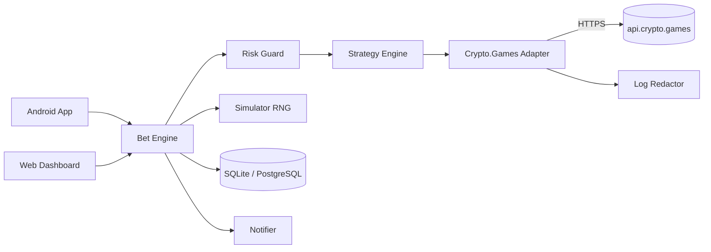
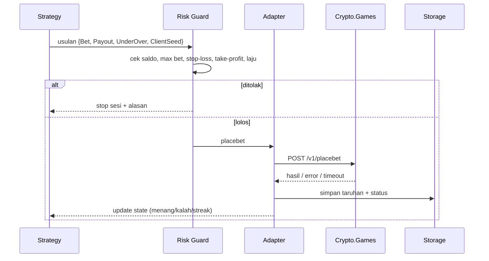

# DiceHub Super App

**Dokumentasi & Rencana Pembangunan**

| | |
|---|---|
| Versi dokumen | 1.0 |
| Tanggal | 30 Oktober 2026 |
| Disusun untuk | bstrd Project |
| Status | Perencanaan — belum ada kode produksi |
| Referensi produk | Relandice Bot CG v2.00 |
| Referensi API | [api.crypto.games](https://api.crypto.games) (v1), diakses 30 Oktober 2026 |

---

## Daftar Isi

1. [Ringkasan Eksekutif](#1-ringkasan-eksekutif)
2. [Peringatan Penting](#2-peringatan-penting)
3. [Tujuan, Target Pengguna, dan Ruang Lingkup](#3-tujuan-target-pengguna-dan-ruang-lingkup)
4. [Referensi API Crypto.Games v1](#4-referensi-api-cryptogames-v1)
5. [Arsitektur Sistem](#5-arsitektur-sistem)
6. [Spesifikasi Fitur](#6-spesifikasi-fitur)
7. [Model Data](#7-model-data)
8. [Keamanan dan Kepatuhan](#8-keamanan-dan-kepatuhan)
9. [Rencana Pembangunan (Roadmap)](#9-rencana-pembangunan-roadmap)
10. [Strategi Pengujian](#10-strategi-pengujian)
11. [Risiko dan Mitigasi](#11-risiko-dan-mitigasi)
12. [Backlog Tugas Awal (Sprint 1)](#12-backlog-tugas-awal-sprint-1)
13. [Glosarium](#13-glosarium)
14. [Lampiran: Log Riset dan Pertanyaan Terbuka](#14-lampiran-log-riset-dan-pertanyaan-terbuka)

---

## 1. Ringkasan Eksekutif

DiceHub adalah aplikasi Android + web dashboard yang mengotomasi taruhan **dice** di Crypto.Games melalui API publiknya. Istilah "super app" di sini berarti satu aplikasi yang menggabungkan:

- eksekusi bot (Play/Stop, foreground service),
- strategy builder dan preset,
- simulator/backtester offline,
- statistik sesi dan riwayat taruhan,
- manajemen multi-akun dan multi-koin,
- notifikasi (stop-loss, error, target tercapai),
- verifikasi provably fair.

### Hasil riset referensi

- **Relandice Bot CG 2.00** adalah aplikasi Android (APK) dengan lima layar: Play, BetSet, Statistics, Account, Info. Login memakai API key Crypto.Games. Fiturnya: direction switching, streak rules, Martingale/progression, divider, statistik global dan per mata uang (profit, win rate, streak, durasi, bets per menit), pengaturan recovery, notifikasi, serta imbauan menonaktifkan battery optimization agar proses tidak dimatikan Android.
- **API Crypto.Games v1** sederhana dan berbasis HTTP/JSON: settings, balance, user, nextseed, bet info, placebet, BalanceAll, AffiliateData (rincian di [bagian 4](#4-referensi-api-cryptogames-v1)).
- Crypto.Games menyatakan **tidak menjamin aplikasi pihak ketiga** dan menganjurkan pengguna memverifikasi kode sumber bot yang dipakai. Karena itu engine DiceHub dirancang agar dapat diaudit.

### Keputusan inti

1. **Engine sebagai library murni** (TypeScript, tanpa dependensi UI) yang dipakai bersama oleh aplikasi Android, web dashboard, simulator, dan mode server.
2. **Default lokal**: API key tidak meninggalkan perangkat. Mode server 24/7 bersifat opsional dan memerlukan persetujuan eksplisit.
3. **Stop-loss aktif secara default** dan merupakan bagian dari Risk Guard, bukan fitur opsional.
4. **Simulasi sebelum uang nyata**: setiap strategi harus bisa diuji minimal 1 juta taruhan offline sebelum dijalankan dengan saldo asli.

---

## 2. Peringatan Penting (Wajib Dibaca Sebelum Membangun)

> **Tidak ada strategi yang mengalahkan house edge.**
> Edge Crypto.Games sebesar 0,8% membuat setiap taruhan memiliki expected value negatif. Martingale, Labouchere, D'Alembert, dan sejenisnya hanya mengubah **distribusi hasil** (sering menang kecil, sesekali rugi besar) — bukan nilai harapan. Aplikasi tidak boleh mengklaim "profit pasti", "sinyal menang", atau "strategi anti-rugi".

1. **Keamanan API key.** Key setara akses penuh ke akun, termasuk saldo. Pada API v1 key dikirim di **path URL** (`/v1/balance/BTC/<key>`), sehingga rawan bocor melalui log, proxy, crash report, dan analytics. Aturan desain: jangan pernah mencatat URL lengkap, simpan key terenkripsi, dan jangan mengirim key ke server pihak ketiga tanpa persetujuan eksplisit pengguna.
2. **Bukan sinyal atau penasihat keuangan.** Aplikasi adalah alat eksekusi aturan buatan pengguna. Batas kerugian (stop-loss) adalah fitur inti, bukan opsional.
3. **Monetisasi.** Jika bot dijual atau dipasangi referral/affiliate, ungkapkan secara jelas. Jangan menjadikan retensi judi sebagai tujuan produk.
4. **Transparansi hasil.** Selalu tampilkan house edge, RTP teoretis (≈ 99,2%), dan drawdown — bukan hanya profit.
5. **Batasan hukum.** Ketersediaan, perizinan, dan usia minimum berbeda per yurisdiksi. Lihat [bagian 8](#8-keamanan-dan-kepatuhan).

---

## 3. Tujuan, Target Pengguna, dan Ruang Lingkup

### 3.1 Tujuan

Bot dice yang **stabil, transparan, dan aman**, dengan pengalaman setara atau lebih baik dari Relandice:

- stabil menjalankan sesi panjang di Android tanpa dimatikan sistem,
- transparan: setiap taruhan dapat diverifikasi secara provably fair,
- aman: key terenkripsi, log tersensor, ada kill switch dan stop-loss.

### 3.2 Target pengguna

Pemain dice berpengalaman yang ingin:

- mengotomasi aturan taruhan (progresi, switching, streak),
- melihat statistik dan drawdown secara real-time,
- menguji strategi secara offline sebelum memakai saldo nyata.

### 3.3 Fase dan ruang lingkup

| Fase | Lingkup |
|---|---|
| **MVP** | Login API key, Play (start/stop), BetSet (Martingale + direction switching), statistik sesi, stop-loss/take-profit |
| **v1** | Strategy builder visual, simulator offline, multi-koin, notifikasi, riwayat taruhan, verifikasi seed, ekspor CSV, web dashboard dasar |
| **v2** | Multi-akun, script engine (sandbox), backtest massal, web dashboard sinkron, mode server 24/7 |

**Di luar lingkup:**

- Game selain dice (roulette, blackjack, plinko, dll.).
- Deposit/withdraw otomatis — tidak ada endpoint resmi pada dokumentasi yang diperiksa, dan risikonya tinggi.
- Klaim prediksi hasil atau "sinyal".
- Menyimpan dana pengguna dalam bentuk apa pun.

### 3.4 Prinsip produk

| Prinsip | Konsekuensi desain |
|---|---|
| Safety first | Simulasi menjadi mode default saat pertama kali membuka Play |
| No dark patterns | Tidak ada notifikasi yang mendorong bet ulang setelah stop-loss |
| Local first | Data dan key tetap di perangkat kecuali pengguna memilih sinkronisasi |
| Auditable | Engine open source / dapat diaudit; rumus dan batas ditampilkan di UI |
| Fail closed | Ragu setelah timeout → berhenti, bukan retry otomatis |

---

## 4. Referensi API Crypto.Games v1

**Base URL:** `https://api.crypto.games`
**Format:** JSON, HTTPS. Tidak ada dokumentasi resmi mengenai autentikasi selain API key di path.

### 4.1 Ringkasan endpoint

| Endpoint | Metode | Fungsi | Catatan |
|---|---|---|---|
| `/v1/settings/:coin` | GET | MinBet, MaxWin, MinPayout, MaxPayout, Edge | Tidak butuh key |
| `/v1/balance/:coin/:key` | GET | Saldo koin | Key di path |
| `/v1/user/:coin/:key` | GET | Nickname, Balance, TotalBets, Profit, Wagered, PendingReferer | Statistik akun untuk dice |
| `/v1/nextseed/:coin/:key` | GET | `NextServerSeedHash` (komitmen seed berikutnya) | Untuk verifikasi |
| `/v1/bet/:id` | GET | Detail taruhan: Roll, Bet, Target, Profit, ServerSeed, ClientSeed, DateCreated | Tanpa key; **tidak** mengembalikan Payout/UnderOver/Balance/NextServerSeedHash |
| `/v1/placebet/:coin/:key` | POST | Pasang taruhan | Body JSON |
| `/v1/BalanceAll/:key` | GET | Semua saldo sekaligus | Skema respons tidak terdokumentasi rinci |
| `/v1/AffiliateData/:key` | GET | Data referral (wagered, deposit, earned) | Skema respons tidak terdokumentasi rinci |

### 4.2 Contoh `settings` (BTC)

```json
{
  "Coin": "BTC",
  "MinBet": 0.000000010000000000,
  "MaxWin": 1.000000000000000000,
  "MinPayout": 1.02,
  "MaxPayout": 9920.0,
  "Edge": 0.80
}
```

### 4.3 Place bet

**Request**

```http
POST /v1/placebet/BTC/<API_KEY>
Content-Type: application/json

{
  "Bet": 0.00001024,
  "Payout": 2.0,
  "UnderOver": true,
  "ClientSeed": "random-string"
}
```

**Response sukses (200)**

```json
{
  "BetId": 327333162,
  "Roll": 47.002,
  "UnderOver": true,
  "ClientSeed": "random-string",
  "Target": " < 49.600",
  "Profit": 0.000010240000000000,
  "Payout": 2.0,
  "ServerSeed": "5PCWsiBDsZ1D07cZ14pYKt0T2HUCkcLoTdF70Cmp",
  "NextServerSeedHash": "4647c8c18b7da5d7174614c6e473864956b42fadf84e24a2f08bd9c2aa69a268",
  "Balance": 0.010010240000000000
}
```

**Error terdokumentasi**

| Kode | Pesan | Arti |
|---|---|---|
| 404 | `Coin not found` | Simbol koin tidak valid |
| 404 | `API key not found` | Key salah/dicabut (terlihat pada endpoint balance) |
| 400 | `Invalid bet ID` | ID taruhan tidak valid (`/v1/bet/:id`) |
| 422 | `Invalid input parameters` | Bet/payout/direction di luar batas atau format salah |

### 4.4 Temuan teknis dari verifikasi dokumentasi (30 Okt 2026)

**a. Hubungan Payout, Target, dan peluang menang**

Roll berada pada rentang `0.000–99.999`. Peluang menang diturunkan dari payout dengan edge 0,8%:

```
chance = (100 − Edge) / Payout        →  chance = 99.2 / Payout
```

Contoh: `Payout = 2.0` → `chance = 49.6%`.

- `UnderOver = true` → menang bila `Roll < Target` (contoh `Target " < 49.600"`).
- `UnderOver = false` → menang bila `Roll > Target` (contoh `Target " > 50.399"`).

Perhatikan pasangan target `49.600` dan `50.399`: keduanya memberi peluang 49,6% pada roll tiga desimal tanpa tumpang tindih di batas. Target **tidak dikirim** oleh klien — klien mengirim `Payout` dan `UnderOver`, lalu server mengembalikan `Target`. Karena itu engine harus **membaca `Target` dari respons**, bukan menghitungnya sendiri, sampai aturan pembulatan tiap koin terverifikasi.

**b. Batas taruhan bertingkat**

Batasan efektif adalah nilai terkecil dari:

```
min( MaxWin / Payout , MaxPayout × Bet , MaxBet(koin) , saldo )
```

Halaman publik dice menampilkan "max bet 2.00 BTC" dan "max win 0.20 BTC", sementara endpoint `settings` untuk BTC menyatakan `MaxWin = 1.0` dan `MaxPayout = 9920`. **Angka UI dan angka API tidak identik.** Selalu pakai `settings` sebagai sumber kebenaran, lalu tangani `422` sebagai sinyal bahwa batas berubah. Jangan hardcode.

**c. Kecepatan taruhan tidak seragam**

Halaman dice menyatakan taruhan ≥ `0.00001 BTC` diprioritaskan; semakin dekat ke minimum koin, semakin lambat server memproses. Implikasi:

- "bets per menit" adalah variabel yang dikendalikan server, bukan hanya kecepatan klien.
- Throttle internal harus adaptif; jangan mengasumsikan 10+ bet/detik.
- Statistik harus mencatat latensi per taruhan (p50/p95).

**d. Tidak ada idempotency key**

`placebet` tidak menerima ID idempoten. `ClientSeed` unik membantu audit, tetapi **tidak** mencegah taruhan ganda bila respons hilang. Jika timeout terjadi setelah request terkirim, taruhan mungkin sudah tercatat. Rencana awal "cek `/v1/bet/:id` saat ragu" tidak cukup karena klien tidak mengetahui `BetId` yang hilang. Mitigasi yang benar:

1. Jangan retry otomatis `placebet`.
2. Setelah timeout, hentikan sesi dan bandingkan saldo via `/v1/balance`.
3. Minta pengguna memeriksa riwayat di situs dan menandai sesi sebagai "perlu rekonsiliasi".
4. Simpan `ClientSeed` agar taruhan tersebut dapat dicari di riwayat situs.

**e. Verifikasi provably fair**

Halaman fairness dan dice menyatakan:

- Server mengumumkan `SHA256(ServerSeed)` sebelum taruhan; setelah taruhan, `ServerSeed` diungkap.
- Roll dihitung dari `SHA512(ServerSeed + ClientSeed)`: ambil lima karakter heksadesimal pertama, konversi ke desimal, lalu ambil lima digit terakhir dan bagi 1000 sehingga menghasilkan nilai `0.000–99.999`. Bila hasil konversi lebih dari enam digit, lewati chunk tersebut dan pakai lima karakter berikutnya.
- UI menyediakan opsi **nonce**, sedangkan respons API tidak memuat nonce. Karena itu verifikasi lewat API perlu diuji: apakah `ClientSeed` di API sudah merepresentasikan pasangan seed+nonce, atau verifikasi hanya valid untuk taruhan pertama pada pasangan seed tersebut.

Prosedur verifikasi minimum yang harus diimplementasikan:

1. Sebelum sesi: `GET /v1/nextseed/:coin/:key` → simpan `H₀`.
2. Setelah taruhan: pastikan `SHA256(response.ServerSeed) == H₀`.
3. Hitung roll dari `ServerSeed + ClientSeed` sesuai algoritma di atas; bandingkan dengan `response.Roll`.
4. Simpan `response.NextServerSeedHash` sebagai `H₁` untuk taruhan berikutnya.
5. Tandai taruhan sebagai `verified`, `mismatch`, atau `unverifiable` (nonce/format tidak dikenal).

**f. Yang masih belum terdokumentasi (jangan diasumsikan)**

| Pertanyaan | Cara menjawab |
|---|---|
| Rate limit per key/IP dan perilaku saat terlampaui (429? blokir?) | Uji bertahap dengan taruhan minimum, catat header respons |
| Arti persis `UnderOver` dan pembulatan `Target` | Matriks uji `Payout × UnderOver` dengan taruhan minimum, bandingkan roll vs target |
| Presisi desimal dan pembulatan tiap koin | Uji `settings/:coin`, kirim nilai di bawah/atas presisi, catat `422` |
| Daftar koin valid | Iterasi kandidat pada `/v1/settings/:coin`; simpan hasil |
| Skema `BalanceAll` dan `AffiliateData` | Rekam respons nyata, buat parser defensif |
| Algoritma roll dengan nonce | Bandingkan dengan verifier pihak ketiga dan riwayat situs |
| Perilaku `422` vs `400` untuk input tidak valid | Uji negatif per field |

> **Aturan:** setiap item di atas harus punya bukti rekaman (request/response tersensor) sebelum masuk kode produksi.

---

## 5. Arsitektur Sistem

### 5.1 Keputusan utama: di mana engine berjalan?

| Opsi | Kelebihan | Kekurangan |
|---|---|---|
| **A. Engine di perangkat** (seperti Relandice) | API key tidak meninggalkan HP; tanpa biaya server; privasi terbaik | Android dapat mematikan proses latar; butuh foreground service |
| **B. Engine di server (cloud)** | 24/7, stabil, mudah dipantau | Server menyimpan key pengguna (risiko kustodian), biaya, tanggung jawab keamanan besar |
| **C. Hybrid** (direkomendasikan) | Default lokal; opsi server untuk 24/7 dengan enkripsi dan persetujuan eksplisit | Kompleksitas kode ganda, dua jalur distribusi |

**Rekomendasi:** engine sebagai **library murni tanpa dependensi UI**, sehingga kode yang sama dipakai di perangkat, server, dan simulator. Perbedaan lingkungan hanya pada *storage*, *clock*, *HTTP transport*, dan *notifier*.

### 5.2 Komponen

| Komponen | Tanggung jawab | Teknologi disarankan |
|---|---|---|
| Client App (Android) | Layar Play, BetSet, Stats, Account, Info; foreground service | React Native/Expo atau Flutter; alternatif Kotlin native |
| Web Dashboard | Statistik, riwayat, builder strategi, kontrol jarak jauh | React + Vite |
| **Bet Engine (core)** | Loop taruhan, state strategi, risk guard | TypeScript (dipakai app + web + server) |
| API Gateway/Backend | Auth pengguna, sinkronisasi profil/strategi, mode server | FastAPI + PostgreSQL + Redis |
| Crypto.Games Adapter | Pembungkus HTTP, retry terbatas, normalisasi error, sensor key | Modul terpisah di dalam engine |
| Simulator | RNG lokal dengan edge 0,8%, Monte Carlo, kurva ekuitas | Modul engine yang sama, mode `dry-run` |
| Notifier | Push/Telegram untuk stop-loss, error, target | FCM + bot Telegram opsional |
| Secure Store | Enkripsi API key | Android Keystore / server KMS |

### 5.3 Diagram



### 5.4 Alur satu taruhan



### 5.5 Prinsip implementasi engine

- **Pure function** untuk perhitungan bet berikutnya: `nextBet(state, strategy, result) → BetPlan`.
- **State machine** eksplisit: `idle → running → paused → stopping → stopped | error`.
- **Deterministic RNG** di simulator (seed dapat diulang untuk pengujian).
- **Uang sebagai integer satoshi/unit terkecil**, bukan `float`, untuk menghindari galat pembulatan.
- **Clock dan transport disuntikkan** (dependency injection) agar bisa diuji.
- **Tidak ada `setInterval` tanpa backpressure**: satu taruhan selesai sebelum menjadwalkan berikutnya.

---

## 6. Spesifikasi Fitur

Berikut padanan layar Relandice dan peningkatan yang diusulkan.

### 6.1 Layar Play

- Tombol **Start/Stop**, status: `Ready`, `Running`, `Paused`, `Stopping`, `Error`.
- Saldo langsung (polling `/v1/balance` atau dari respons taruhan).
- Pilihan koin dan mode **Real / Simulasi** (default Simulasi).
- Taruhan terakhir: roll, target, arah, profit, saldo.
- Log taruhan ringkas (virtualized) dan indikator **bets/menit** + latensi p95.
- Banner stop-loss/take-profit yang sedang aktif.
- Konfirmasi eksplisit saat beralih dari Simulasi ke Real.

### 6.2 Layar BetSet (Strategi)

**Parameter dasar**

- Base bet (absolut atau % saldo), payout/chance, arah (over/under).
- Batas: min/max payout yang diizinkan koin.

**Direction switching**

- Tetap.
- Ganti tiap N kekalahan.
- Ganti tiap menang.
- Ganti tiap N taruhan.
- Acak dengan seed yang dapat direproduksi.

**Progresi**

- Martingale (pengali, dengan cap).
- Anti-Martingale.
- D'Alembert.
- Fibonacci.
- Labouchere.
- Divider / base bet persen saldo.

**Streak rules**

- Reset setelah N kemenangan/kekalahan.
- Naikkan payout pada streak tertentu.
- Berhenti setelah N kekalahan beruntun.

**Risk guard (wajib, tidak bisa dimatikan)**

| Guard | Default |
|---|---|
| Max bet absolut | 0,5% saldo awal |
| Stop-loss sesi | 20% saldo awal |
| Take-profit sesi | opsional |
| Maks taruhan per sesi | 1.000 |
| Maks kekalahan beruntun | 10 |
| Laju maksimum | 2 taruhan/detik, adaptif |
| Saldo minimum | min bet × 10 |
| Kill switch | 3 error beruntun / saldo turun tak wajar |

**Lainnya**

- Preset tersimpan, impor/ekspor JSON dengan `version` dan validasi skema.
- Pratinjau risiko: estimasi drawdown dan probabilitas ruin dari simulator (bukan janji hasil).

### 6.3 Layar Statistics

- Global dan per koin: profit, wagered, win rate, streak menang/kalah terpanjang, durasi sesi, bets/menit, drawdown maksimum.
- Grafik ekuitas, histogram roll, distribusi profit per taruhan.
- Perbandingan hasil nyata vs ekspektasi teoretis (RTP 99,2%).
- Tombol reset statistik (dengan konfirmasi dan opsi ekspor dulu).

### 6.4 Layar Account

- Login API key (disimpan terenkripsi), tampilkan nickname dan saldo dari `/v1/user`.
- Pengaturan: recovery otomatis setelah koneksi putus, getar, layar tetap menyala, notifikasi, panduan battery optimization.
- Multi-akun (v2), tombol "hapus semua data" (key, riwayat, statistik).
- Indikator kesehatan key: valid, dicabut, tidak dikenal (404).

### 6.5 Layar Info

- Versi, changelog, panduan, kontak dukungan.
- Peringatan risiko dan tautan bermain bertanggung jawab (Crypto.Games: `/responsiblegaming`, `/selfexclusion`).
- Penjelasan house edge dan provably fair.
- Status API (opsional): hasil cek `/v1/settings/BTC` terakhir.

### 6.6 Fitur "Super App" tambahan

| Fitur | Deskripsi | Fase |
|---|---|---|
| Simulator / Backtest | Jutaan taruhan offline, kurva ekuitas, probabilitas ruin, drawdown | v1 |
| Verifikator Seed | Cek `SHA256(ServerSeed)` vs hash komitmen dan hitung ulang roll | v1 |
| Strategy Builder visual | Aturan "jika-maka" tanpa kode, divalidasi terhadap skema | v1 |
| Script Engine | Skrip kustom dalam sandbox (tanpa akses jaringan/penyimpanan) | v2 |
| Multi-akun | Beberapa key sekaligus, statistik terpisah | v2 |
| Mode server 24/7 | Engine di cloud, kontrol dari web | v2 |
| Laporan | Ekspor CSV/JSON riwayat dan statistik | v1 |
| Mode aman | Batas keras yang tidak bisa dilampaui preset | MVP |

---

## 7. Model Data

| Entitas | Atribut utama |
|---|---|
| `Account` | `id`, `nickname`, `encrypted_api_key`, `coin_default`, `created_at` |
| `Strategy` | `id`, `name`, `version`, `json_config`, `schema_version`, `created_at` |
| `Session` | `id`, `account_id`, `strategy_id`, `coin`, `mode(real/sim)`, `started_at`, `ended_at`, `start_balance`, `end_balance`, `stop_reason`, `reconciled` |
| `Bet` | `id`, `session_id`, `bet_id_remote`, `bet_amount`, `payout`, `under_over`, `target`, `roll`, `profit`, `balance_after`, `server_seed_hash`, `server_seed`, `client_seed`, `latency_ms`, `verify_status`, `created_at` |
| `SessionStats` | `session_id`, `bets`, `wins`, `losses`, `max_win_streak`, `max_loss_streak`, `max_drawdown`, `bets_per_min`, `wagered` |
| `Settings` | `account_id`, `notifications`, `keep_awake`, `recovery`, `theme`, `locale` |

**Catatan**

- Uang disimpan sebagai integer unit terkecil (mis. satoshi) + `decimals` per koin; konversi ke desimal hanya untuk tampilan.
- `server_seed` adalah data sensitif-historis: hanya disimpan setelah terungkap, dan boleh dihapus pengguna.
- `stop_reason` enum: `user`, `stop_loss`, `take_profit`, `max_bets`, `error`, `balance_low`, `reconciling`, `app_killed`.
- **Penyimpanan lokal:** SQLite (aplikasi), dengan migrasi berversi.
- **Server:** PostgreSQL (riwayat) + Redis (state sesi aktif). Redis tidak menyimpan key mentah.

---

## 8. Keamanan dan Kepatuhan

### 8.1 Perlindungan API key

- **Android:** Android Keystore (AES-GCM), key tidak pernah masuk `SharedPreferences` polos.
- **Server:** envelope encryption dengan KMS, akses minimal, rotasi key, audit log akses.
- **Log redaction:** sensor segmen path URL pada **semua** interceptor HTTP, termasuk error handler dan crash reporter. Terapkan daftar pola: `/v1/*/<key>`, header `Authorization`, body yang memuat key.
- **Tidak ada key** di analytics, telemetry, screenshot, clipboard, atau pesan notifikasi.
- **TLS only** + certificate pinning untuk `api.crypto.games` (siapkan jalur update pin).
- **Panduan pengguna:** buat key khusus bot bila memungkinkan, rotasi berkala, cabut jika perangkat hilang.

### 8.2 Keamanan operasional

- Izin Android minimal; foreground service dengan notifikasi persisten.
- Rate limiting internal dan backoff eksponensial pada 5xx/timeout.
- Kill switch: 3 error beruntun, saldo tidak sesuai ekspektasi, atau roll/target tidak valid → berhenti.
- **Fail closed** pada timeout `placebet`: berhenti dan tandai sesi untuk rekonsiliasi.
- Validasi input ketat (payout, bet, arah, presisi) sebelum request.
- Tidak ada evaluasi kode dari sumber tidak tepercaya di proses utama (script engine v2 wajib sandbox).

### 8.3 Kepatuhan

- Pemeriksaan usia 18+, disclaimer risiko, dan pembatasan wilayah sesuai kebijakan hukum.
- Tinjauan ToS Crypto.Games sebelum distribusi; operator adalah MuchGaming B.V. (Curaçao).
- Tautan bermain bertanggung jawab dan self-exclusion.
- Transparansi monetisasi/afiliasi.
- Engine idealnya open source atau dapat diaudit, sejalan dengan anjuran Crypto.Games untuk memverifikasi kode bot pihak ketiga.

---

## 9. Rencana Pembangunan (Roadmap)

Estimasi untuk 1–2 developer. Durasi bersifat indikatif dan belum termasuk buffer.

| Fase | Durasi | Deliverable | Kriteria Selesai |
|---|---|---|---|
| **0. Riset / Uji API** | 1 minggu | Dokumen perilaku API (rate limit, desimal, UnderOver, koin), koleksi Postman, rekaman respons tersensor | Semua endpoint teruji dengan taruhan minimum; pertanyaan di §4.4f terjawab atau ditandai risiko |
| **1. Core Engine** | 2 minggu | Adapter API, strategy engine, risk guard, simulator, unit test | Simulasi 1 juta taruhan; edge hasil ≈ 0,8%; RTP ≈ 99,2% |
| **2. MVP Android** | 3 minggu | Layar Play, BetSet, Stats, Account; foreground service; SQLite | Sesi nyata 1 jam stabil di 2 perangkat; tidak ada key di log |
| **3. Hardening** | 1 minggu | Pen-test ringan, sensor log, penanganan jaringan putus, recovery, rekonsiliasi | Tanpa kebocoran key; skenario timeout teruji; kill switch berfungsi |
| **4. Beta Tertutup** | 2 minggu | APK ke 10–20 penguji, telemetri tanpa data sensitif | Bug kritis nol; crash-free ≥ 99%; stop-loss tidak bisa dilewati |
| **5. v1 Rilis** | 3 minggu | Strategy builder, backtest, verifikator seed, ekspor CSV, web dashboard dasar | Checklist fitur v1 selesai; verifikasi seed lolos pada 100 taruhan uji |
| **6. v2** | 6+ minggu | Multi-akun, script engine, mode server 24/7 | Audit keamanan sebelum mode server dibuka |

**Tim/peran:**

- 1 engineer engine/backend (TypeScript/Python),
- 1 engineer mobile/React,
- desain UI (dapat dikerjakan sendiri mengingat fokus branding),
- QA paruh waktu.

**Gate antar-fase**

- Fase 1 → 2: ≥ 90% coverage pada strategy engine dan risk guard; simulator reproducible.
- Fase 2 → 3: sesi 1 jam tanpa crash dan tanpa taruhan ganda.
- Fase 3 → 4: audit log memastikan tidak ada key; uji timeout dan pemutusan jaringan lolos.
- Fase 5 → 6: verifikator seed cocok dengan minimal 100 taruhan nyata.

---

## 10. Strategi Pengujian

| Jenis | Fokus | Kriteria |
|---|---|---|
| Unit test | Setiap strategi: urutan bet, reset, cap | Deterministik dengan seed RNG tetap |
| Property test | Bet tidak pernah > max bet/saldo; stop-loss selalu menghentikan sesi | 10.000 kasus acak, tanpa pelanggaran |
| Simulasi statistik | Jutaan taruhan | RTP konvergen ke ≈ 99,2%; distribusi sesuai teori |
| Contract test | Parsing respons, error 404/400/422, timeout | Rekaman respons nyata; parser defensif |
| Uji ketahanan | Jaringan putus di tengah taruhan, timeout, app dibunuh | Tidak ada taruhan ganda tanpa konfirmasi; sesi ditandai untuk rekonsiliasi |
| Uji keamanan | Log, crash report, screenshot, penyimpanan | Nol kemunculan key |
| Uji perangkat | Vendor Android agresif mematikan proses, variasi baterai | Sesi bertahan dengan foreground service + panduan battery optimization |
| Uji fairness | Hash komitmen + roll | 100% cocok pada taruhan uji, atau ditandai `unverifiable` dengan alasan |

**Uji negatif API yang wajib direkam**

- Bet di bawah `MinBet` dan di atas `MaxWin / Payout`.
- `Payout` di luar `MinPayout`–`MaxPayout`.
- Koin tidak valid, key tidak valid, `BetId` tidak valid.
- `ClientSeed` kosong/terlalu panjang/karakter khusus.
- Request ganda dengan `ClientSeed` sama (apakah ditolak atau diterima?).

---

## 11. Risiko dan Mitigasi

| Risiko | Dampak | Mitigasi |
|---|---|---|
| Perubahan/penghentian API | Bot berhenti | Adapter terisolasi, pemantauan versi, uji kontrak harian |
| Rate limit tak terdokumentasi | Akun dibatasi | Throttle adaptif, backoff eksponensial, prioritas bet besar sesuai perilaku server |
| Kebocoran API key | Kehilangan dana | Enkripsi, sensor log, key terpisah, rotasi, panduan pencabutan |
| Pengguna kehilangan dana besar | Reputasi, hukum | Stop-loss default aktif, peringatan Martingale, batas bet bawaan, mode simulasi default |
| Android mematikan service | Sesi terhenti | Foreground service, panduan battery optimization, recovery |
| Taruhan ganda saat jaringan putus | Kerugian ganda | Tanpa retry otomatis; `ClientSeed` unik; rekonsiliasi saldo; tandai sesi |
| `BetId` hilang saat timeout | Tidak bisa audit langsung | Simpan `ClientSeed`; arahkan pengguna ke riwayat situs; cek saldo |
| Presisi desimal salah | `422` atau bet tak terduga | Integer unit terkecil; validasi per koin; uji batas |
| Perbedaan batas UI vs API | Bet ditolak | Selalu baca `settings`; tangani `422` sebagai perubahan batas |
| Nonce tidak tersedia di API | Verifikasi seed gagal sebagian | Uji algoritma; tandai `unverifiable`; jangan klaim "verified" palsu |
| Isu hukum/ToS | Pemblokiran distribusi | Tinjauan hukum, pembatasan wilayah, kepatuhan ToS |
| Klaim berlebihan di marketing | Kepercayaan hilang | Larang kata "profit pasti"/"sinyal"; tampilkan RTP dan drawdown |

---

## 12. Backlog Tugas Awal (Sprint 1)

1. Buat repo monorepo: `engine/`, `app/`, `server/`, `docs/`.
2. Implementasi `CryptoGamesAdapter` (settings, balance, user, nextseed, placebet, bet info) dengan redaksi key.
3. Tulis eksperimen API: matriks `Payout × UnderOver`, catat `Target`, roll, dan `422`.
4. Implementasi simulator RNG dan strategi Martingale + direction switching.
5. Implementasi Risk Guard dan 20 unit test.
6. Prototipe layar Play dan BetSet.
7. Rancang skema SQLite dan migrasi.
8. Buat koleksi Postman + skrip rekaman respons tersensor.
9. Definisikan skema JSON strategi (versi 1) dan validatornya.
10. Siapkan checklist keamanan log sebelum kode pertama menyentuh jaringan.

**Definition of Done Sprint 1**

- Semua endpoint di atas dapat dipanggil dari adapter dengan key dummy/nyata-minimal.
- Simulator menghasilkan RTP ≈ 99,2% pada 1 juta taruhan.
- Tidak ada URL berkunci yang tercetak di log (dibuktikan dengan tes otomatis).

---

## 13. Glosarium

| Istilah | Arti |
|---|---|
| **House edge** | Keuntungan statistik rumah (0,8% pada Crypto.Games) |
| **Payout** | Pengali kemenangan; menentukan peluang menang (`99,2 / payout`) |
| **Target** | Ambang roll yang dikembalikan server, mis. `< 49.600` atau `> 50.399` |
| **ClientSeed / ServerSeed** | Komponen provably fair; hash seed server diumumkan sebelum taruhan |
| **NextServerSeedHash** | Komitmen SHA256 untuk seed server berikutnya |
| **Martingale** | Menggandakan bet setelah kalah; risiko kebangkrutan tinggi |
| **Drawdown** | Penurunan terbesar dari puncak ekuitas |
| **RTP** | Return to player, ≈ 100% − house edge = 99,2% |
| **Reconciliation** | Proses mencocokkan taruhan yang statusnya tidak pasti setelah timeout |
| **Kill switch** | Penghentian otomatis saat error beruntun atau anomali saldo |

---

## 14. Lampiran: Log Riset dan Pertanyaan Terbuka

### 14.1 Sumber yang diperiksa (30 Oktober 2026)

| Sumber | Yang diambil |
|---|---|
| `https://api.crypto.games` | Dokumentasi endpoint, contoh request/response, kode error |
| `https://crypto.games/dice` | Rentang roll `0.000–99.999`, algoritma SHA512, nonce, batas max bet/win, perilaku kecepatan bet |
| `https://crypto.games/fairness` | Prinsip komitmen seed, verifier pihak ketiga, audit RNG |

### 14.2 Pertanyaan terbuka (pemilik: tim engine)

| # | Pertanyaan | Metode | Blocker untuk |
|---|---|---|---|
| Q1 | Rate limit per key/IP? Header apa yang muncul? | Uji bertahap 1→20 bet/detik, catat 429/5xx | Throttle, MVP |
| Q2 | `UnderOver=true` selalu berarti "under"? | Matriks 6 payout × 2 arah, taruhan minimum | Strategy engine |
| Q3 | Bagaimana pembulatan `Target` (3 desimal)? | Bandingkan target respons vs `99,2/payout` | Strategy engine |
| Q4 | Presisi & pembulatan tiap koin | Uji nilai batas, catat `422` | Multi-koin v1 |
| Q5 | Daftar koin valid | Iterasi `settings/:coin` | Multi-koin v1 |
| Q6 | Skema `BalanceAll`/`AffiliateData` | Rekam respons | Account v2 |
| Q7 | Apakah `ClientSeed` duplikat ditolak? | Kirim dua request dengan seed sama | Rekonsiliasi |
| Q8 | Nonce dan verifikasi roll | Bandingkan dengan verifier + riwayat situs | Verifikator seed v1 |
| Q9 | Apakah `ServerSeed` di respons adalah seed taruhan tersebut? | `SHA256(ServerSeed)` vs `NextServerSeedHash` sebelumnya | Verifikator seed v1 |
| Q10 | Perilaku saat key dicabut di tengah sesi | Cabut key saat sesi berjalan | Recovery |

### 14.3 Changelog dokumen

| Versi | Tanggal | Perubahan |
|---|---|---|
| 1.0 | 30 Okt 2026 | Draft awal: ringkasan, API, arsitektur, fitur, roadmap, risiko |

---

> **Disclaimer:** Dokumen ini adalah rencana teknis, bukan ajakan berjudi. Tidak ada strategi yang menghilangkan house edge. Gunakan hanya dana yang siap hilang, dan patuhi hukum serta ketentuan layanan yang berlaku di wilayah Anda.
